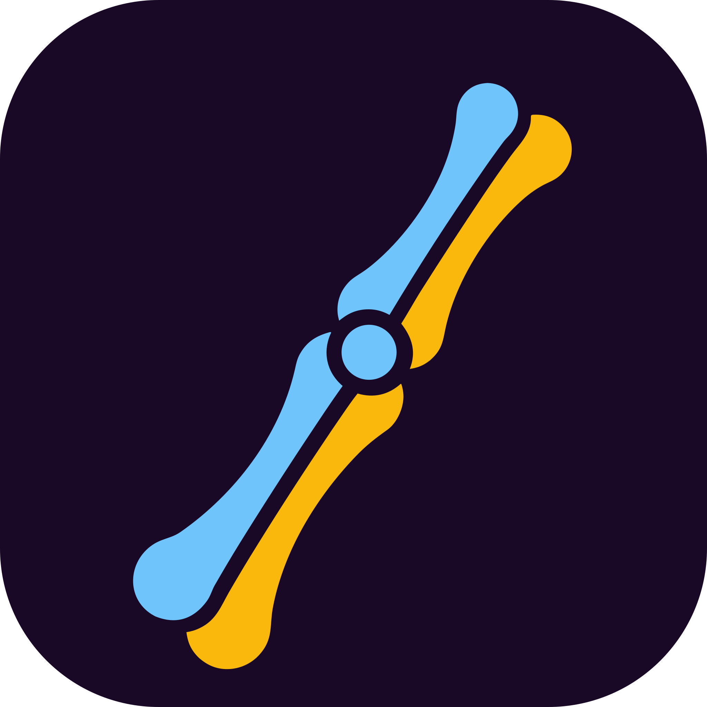
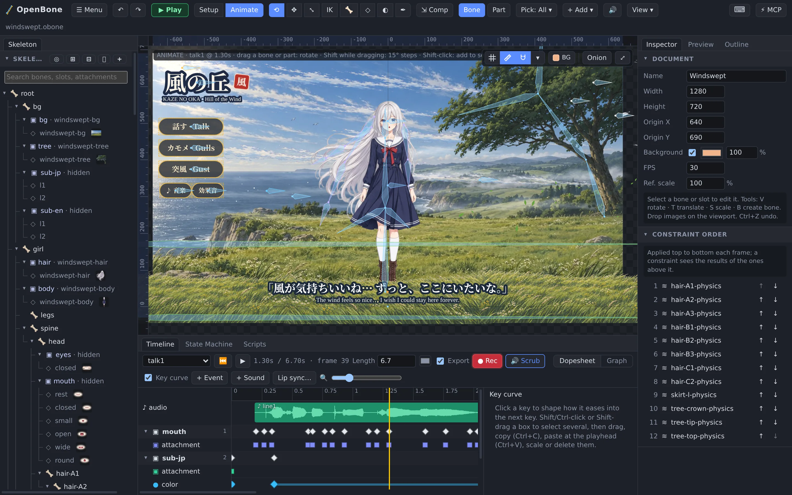

<p align="center"></p>

<h1 align="center">OpenBone</h1>

**Open-source 2D skeletal animation (Spine-style rigging) + Rive-style interactivity + an MCP server so AI agents can build animations for you.**



## Features

### Rigging
- **Bones** with parent/child hierarchy, length, rotation, translation, scale and shear, and inherit modes (normal, only translation, no rotation, no scale).
- **Slots** with draw order, colour/alpha tint, **two-colour tint** (a keyable dark colour for the image's shadows, like Spine's tint black; Canvas2D and WebGL2) and blend modes (normal, additive, multiply, screen).
- **Skins**: create, duplicate, rename and delete outfits, switch them live in the viewport, player and previews; attachments can override the default skin per outfit.
- **Constraints**
  - **IK**: 1- and 2-bone, mix, bend direction, softness, stretch, compress and uniform scaling; mix and softness blend between keys, bend/stretch/compress key in steps (like Spine's IK timeline).
  - **Transform**: rotate/translate/scale/shear mixes, world or local space, absolute or relative.
  - **Path**: place and rotate a bone chain along a bezier path, with position, spacing and rotate modes.
  - **Physics**: secondary motion (hair, cloth, tails) with inertia, strength, damping, gravity and wind; deterministic fixed timestep.
  - **Sliders**: a bone's property (e.g. shoulder rotation) or a number input scrubs an animation: corrective shapes, shadows, dials. Range-to-time mapping, mix, loop and additive; applied before the other constraints.

### Attachments
- **Regions** (images), **vector shapes** (rect, rounded rect, ellipse, polygon with fill and stroke), **points** and **bounding boxes** (hit areas).
- **Meshes**: deformable, weighted to bones, with free-form deform keys. **Linked meshes** reuse a mesh's vertices, triangles and weights with another image (the same rigged sleeve in every outfit) and can follow its deform keys; edit the parent and they all update. **Trace mesh** builds one automatically from an image's visible pixels (outline detail, padding and inner vertices to choose; honours the region's rotation and scale), so less transparent area is drawn and the mesh bends with the art.
- **Clipping masks**: slots after the mask, up to an end slot, are drawn only inside its outline (Canvas2D clip, WebGL2 stencil).
- **Bezier paths** for path constraints, optionally weighted to bones.
- **Sprite sequences**: frame-by-frame animation from numbered image files (After Effects / render output, sorted naturally), sprite sheets cut by a grid or read from TexturePacker / Aseprite JSON (hash or array, trimmed frames), or a ZIP of frames. Own fps, loop / once / ping-pong / hold-last, start offset; driven by animation or state time, by frame keys, or by a number input. Works with skins, clipping, draw order and the atlas.
- **Particle emitters** on any slot: rate and bursts, point/circle/box/cone shapes, world or local space, lifetime, speed, gravity, drag, size, rotation and colour-over-life ranges, soft circle / square / spark streak / image looks, blend modes, and presets (fire, smoke, sparks, confetti, exhaust, coins). Seeded and deterministic, so the editor preview and image/video exports show the same particles; emitting and rate are keyable, and state machines can start, stop or burst them.
- **Text attachments** (font, size, weight, colour, alignment, outline) whose content can be a live template bound to inputs.
- **Texture atlas packing** (MaxRects): fewer GPU draw calls and single-file exports; optional **rotation** (images turn 90° when that packs tighter) and **scaling** (store images at 75/50/25%, or *Auto* to shrink just enough to fit one page).

### Animation
- Per-property timelines: bone rotate/translate/scale/shear, slot colour and attachment, IK/transform/path/physics constraint values, mesh and path deform, sequence frame, particle emitting and rate, draw order.
- **Key editing**: select many keys (Shift/Ctrl-click, Shift-drag a box, Ctrl/⌘+A), drag or nudge them together, **copy and paste** them at the playhead (into this or another animation), **scale** them in time around a pivot, change their curve or delete them at once.
- Linear, stepped and bezier curves. The Timeline's **Graph view** shows every numeric timeline as value curves over time: drag keys in time and value, shape bezier handles on the curve, pan, zoom, fit, and normalize curves of different units; a per-key ease editor sits beside the dopesheet.
- **Full-width dopesheet timeline** with a **● Rec** button (keys past the end extend the animation), grouped by bone, slot and constraint (collapsible, with summary keys that move a group's keys together), keys coloured per property and shaped by curve type, hold bars where a value stays the same, auto-key, key dragging, events (with int/float/string payloads and audio references).
- Per-animation **Export** switch (helper animations stay out of exports) and **colour**.
- Track mixing and cross-fades at runtime.
- **Onion skin**: ghost poses before (red) and after (green) the current frame.

### Interactivity (Rive-style)
- **State machines** with layers, bool/number/string/trigger inputs, animation and 1D blend states, any-state transitions, conditions, exit times, cross-fades, **"on complete" hand-offs** for staged flows (play once, then continue) and **inputs set on enter** (reset a round when going back to idle). The graph pans, zooms and fits to view.
- **Live data**: **text attachments** whose content is a template bound to inputs (`{multiplier:0.00}x`, thousands separators, signs, percent), and **input bindings** that drive bone, slot (colour, alpha) and constraint properties from a number input with a clamped linear mapping. See the crash-game example.
- **Pointer listeners** on hit boxes (down, up, enter, exit, move, click) that set inputs, fire triggers, report events, play or stop sounds, start or stop particles, or run scripts.
- **Sandboxed scripts** (QuickJS-WASM, memory cap and per-call deadline) with an `ob` API: `onStart`, `onUpdate`, `onEvent`, `onPointer`.

### Audio
- **Sounds** from WAV, MP3 or OGG files (embedded or by path), each with a bus, volume, rate (pitch), loop and fade in/out.
- The timeline's audio lane shows each sound's **waveform**, so keys can be timed by eye. **Lip sync** analyses a voice recording and keys a mouth slot's images to it (rest, closed M/B/P, small, open, wide, round), from the current time, in one undo step; see the Fox and Robot examples.
- Played by **audio keys** on an animation's timeline, by **events** (every time the event fires), by **state hooks** (play/stop on enter or exit) and by **listener actions**. Looping sounds fade out when their state or animation ends.
- **Mixer**: named buses (sfx, music, ui, or your own) with volume and mute, and a master volume. The runtime only emits play/stop/fade commands; the player and editor play them with Web Audio, unlocking on the first click or key press.

### Editor
- **Selection**: drag a box on empty space to select many bones (Shift adds, Ctrl/⌘ removes, Shift-click toggles); drag, rotate, scale or key (`K`) them together.
- **Tools**: select/rotate, translate, scale, **Pose** (`I`: drag any bone and it plus its parents bend to follow, inverse kinematics without setting up a constraint; chain length 1–5 or to the root, Shift for just the grabbed bone; keys in Animate mode), create bone, **mesh vertex editing** (select, drag, add, delete, nudge; re-triangulates) with **soft selection** (nearby vertices follow with a falloff), and **weights** (brush with add/remove, radius and strength, heat-map; **Direct** mode sets selected vertices' weights per bone; **lock bones** so their weights stay put while the others renormalise around them; **Smooth**, **Auto**, **Prune** and **Swap** two bones' weights on the mesh or its selected vertices).
- **Setup and Animate modes**, undo/redo for every change. **Compensate** (`J`): move, rotate or scale a bone while its child bones stay where they are.
- **Photoshop import**: drop a `.psd` (or pick it with + Image) and every layer becomes an image, slot and region in place, in the same stacking order, with opacity and blend modes; groups can become bones and hidden layers can be skipped.
- **Folders** (like Spine's) for slots, skins, animations, events, constraints and state machines: drag items in, create, rename and delete folders (deleting moves the contents up a level); collapsed folders are remembered. Folders only organise the lists, never drawing or posing.
- **Import from project…** (☰ Menu, like Spine's Import data): pick animations and skins from another `.obone`/`.obonb` (bones, slots, constraints and events matched by name, images and sounds brought along, name conflicts renamed, replaced or skipped) or bring in its whole skeleton under a new root bone, as one undo step.
- **Skeleton tree** with parent/child guide lines, collapsible bones and slots (Alt-click: a whole branch), **search** (matches shown with their parents; Enter selects the first) and auto-scroll to whatever you select in the viewport.
- **Viewport aids**: checkerboard (transparent backgrounds supported), origin lines, red/green **move arrows** on the selected bone (axis-locked dragging), grid, rulers, draggable guides (saved per project) and **smart snapping** to the artboard centre/edges/origin, guides, grid, other bone joints and mesh vertices (hold Ctrl/⌘ to bypass).
- **Dockable workspace**: resize panels, drag panel tabs to any side or group them, split a dock in two (drop a tab on its lower or right part; Layout → "Preview under the Inspector"), collapse sections; the layout is remembered and can be reset. File commands, Examples (a gallery with live previews) and Layout live under the ☰ Menu button, and right-click opens editor context menus (bone and slot actions, tools, view toggles).
- **Play mode** (▶ Play, `P`): run the result in the editor exactly as shipped, with a floating panel to toggle inputs, fire triggers and watch events, state changes and script logs; pick the state machine or animation, skin and speed, fit or 1:1, full window. Stop returns to the exact editing state.
- **Keyboard shortcuts** that use ⌘ on macOS and Ctrl on Windows/Linux, with a searchable reference (`?`) where every key can be rebound (conflict-checked, saved per browser).
- **Preview** panel (plays an animation or runs a state machine live, clickable, while you edit), **Outline** minimap (click to move the view) and **Stats** (bones, vertices, vertex transforms, triangles, clipping, estimated draw calls).
- In-app dialogs and a live MCP connection that shows an agent's edits as they happen.

### Export
- **OpenBone project** (`.obone`): the whole project, to open and keep editing later.
- **Data**: JSON (`.json`) or compact **binary** (`.obonb`, about 40% of JSON), with a choice of animations, state machines, scripts and skins, plus nonessential-data stripping, animation clean-up, embedded images and atlas packing.
- **Images**: PNG and JPEG (one frame or a ZIP of every frame), animated **GIF** and **APNG**, layered **PSD** (one layer per frame).
- **Video**: **AVI** and **MOV** (Motion-JPEG).
- **Web**: the `<openbone-player>` web component as a classic script (`window.OpenBone`) or an ES module, **minified (≈ 90 KB, 32 KB gzipped) or readable**, plus your animation, a demo page with controls for the inputs and a README with embed snippets (ZIP), or **one self-contained HTML file** that works without a server. In ZIPs the script sandbox ships as separate files (`openbone-scripts.js` + `quickjs.wasm`) that are downloaded only when an animation has scripts. Embedded images are re-encoded as **WebP** when smaller (the knight example: 470 KB → 71 KB), or kept lossless.
- **Engines**: sprite-sheet packs (trimmed, packed sheets with frame metadata) for **Unity** (TexturePacker/Unity JSON + import guide), **Godot 4** (ready `SpriteFrames` `.tres` and an `AnimatedSprite2D` scene), **Flutter** (sheet + JSON + Flame snippet) and generic engines (TexturePacker hash/array JSON for Phaser, PixiJS, Cocos); plus **interactive WebView packages** for **Flutter**, **Android** (Kotlin `OpenBoneView`) and **iOS** (Swift, UIKit and SwiftUI) that run the full file (state machines, inputs, scripts) through a small JS bridge (`setInput`, `fire`, `play`, events back to the app). The native templates are not compiled in CI; see their READMEs.
- Animation, skin, frame rate, scale, artboard or fit-to-content area, transparent or coloured background, quality and looping options; a live preview; export settings can be saved to a file and loaded again.

### Runtime and tools
- Renderer-agnostic TypeScript runtime with **WebGL2** (batched) and **Canvas2D** renderers, and runtimes for **PixiJS**, **Phaser**, **Three.js** and **CanvasKit** (see [Runtimes](#runtimes)).
- **`<openbone-player>`** web component and a `Player` class (loads `.obone`, `.json` and `.obonb`).
- **MCP server** (120 tools; every editing op becomes a tool automatically) covering everything the editor does: render/simulate, every export format, trace mesh, lip sync, the Pose tool, weight clean-up and stats, plus a live WebSocket bridge to the editor.
- **CLI**: validate, summarize, render PNG/GIF, simulate state machines, apply any op.
- **Desktop app** (Tauri 2) with native file dialogs.

Everything in this repository is **MIT** and built only on permissively licensed open-source dependencies.

## Quick start

```bash
pnpm install
```

```bash
pnpm dev
```

The editor opens at http://localhost:5180 with the *Walker* example: a painted adventurer with IK legs, a scarf mesh, an idle/walk blend eased by a script, a crouch-tuck-land jump and a forest that scrolls in parallax as he walks (click the path to walk, click him to jump). The *Examples* gallery (☰ Menu → Examples…) also has a side-view **knight** with sword and shield (walk along a scrolling castle road, attack with swing and clang, salute with a spoken greeting), **Pip the fox** (lip sync with a real voice), a painted **robot** (lip sync with a robot voice), a **tail** creature (a painted tail mesh bending along a path, spring antennae, a hop, and a slow camera pan on a second state-machine layer that moves the meadow, the creature and the grass at different depths), a **rocket** on its launch pad (click to launch: it flies out of frame as the space centre falls away, then lands back on the pad; particles, ignition and engine sounds), a **crash game** (staged flow idle → fly-out → flying → crash or cash-out, a live multiplier text, input bindings that also move the sky, clouds and ground in parallax), an interactive button (state machine, clipping mask, hover and click sounds) and a campfire (sprite-sequence flames on painted logs, flickering firelight, a bending flame mesh, a crackle loop). Every example has sound. All the characters, backgrounds, sounds and voices were made with ElevenLabs (see [examples/assets/eleven/LICENSE.md](examples/assets/eleven/LICENSE.md)), except the button and the explosion frames, made with Canva ([examples/assets/canva/LICENSE.md](examples/assets/canva/LICENSE.md)). All of it is MIT like the rest of the repo. Press **▶ Play** to try any of them. Each card in the gallery also has **⬇ Download**, which saves the example as one `.obone` file with all its art and sound inside. A deployment can host the examples elsewhere (a GitHub Release, a CDN): build with `VITE_OPENBONE_EXAMPLES_URL=https://…/` and the editor loads them from there, and the build no longer copies them. The player demo is at http://localhost:5180/player.html.

```bash
pnpm test
```

### Let an agent animate (MCP)

This repo ships `.mcp.json`, so Claude Code picks up the `openbone` server automatically. For other clients:

```json
{ "mcpServers": { "openbone": { "command": "pnpm", "args": ["exec", "tsx", "/path/to/OpenBone/packages/mcp/src/bin.ts"] } } }
```

Then ask: *"Create a project at ~/anim/robot.obone: a robot with IK arms, an idle and a wave animation, and a state machine that waves when clicked."* Click **⚡ Connect MCP** in the editor to watch it happen live (the bridge listens on `ws://127.0.0.1:7717`). See [docs/mcp.md](docs/mcp.md).

### CLI

```bash
pnpm cli render examples/walker.obone --animation walk --time 0.25 --out walk.png
```

```bash
pnpm cli simulate examples/walker.obone --steps '[{"setInputs":{"speed":1},"advance":1},{"fire":["jump"],"advance":1}]'
```

`pnpm cli` with no arguments lists every command (validate, summary, render, gif, simulate, apply, ops, mcp).

### Desktop

```bash
pnpm desktop
```

Requires Rust and the Tauri system dependencies (on Linux: webkit2gtk-4.1, GTK 3).

### Embed in a website

```html
<script type="module">
  import { definePlayerElement } from "@openbone/player";
  definePlayerElement();
</script>
<openbone-player src="walker.obone" state-machine="character"></openbone-player>
<script>
  const p = document.querySelector("openbone-player");
  p.setInput("speed", 1);
  p.addEventListener("openbone-event", (e) => console.log(e.detail.name));
</script>
```

## Runtimes

Every runtime builds on the TypeScript runtime (`OpenBoneInstance` for posing, animations, state machines, listeners, events and scripts) and draws `Skeleton.drawList()` in the same batches as the WebGL renderer, with tests that check its geometry against it frame for frame.

| Runtime | Package | Engine | Notes |
|---|---|---|---|
| TypeScript | `@openbone/runtime` | any | Posing, constraints, animation mixing, state machines, listeners, particles, text, audio commands |
| Web player | `@openbone/player` | browser | `<openbone-player>` element and `Player` class, WebGL2 or Canvas2D, Web Audio |
| WebGL2 | `@openbone/render-webgl` | browser | Batched reference renderer, stencil clipping |
| Canvas2D | `@openbone/render-canvas` | browser, Node | Editor viewport, headless PNG/GIF |
| PixiJS | [`@openbone/pixi`](packages/pixi) | PixiJS v8 | A `Container`; stencil-mask clipping, Pixi pointer events |
| Phaser | [`@openbone/phaser`](packages/phaser) | Phaser 3 | Scene plugin: `this.load.openbone()`, `this.add.openbone()`; WebGL (MultiPipeline) and Canvas |
| Three.js | [`@openbone/three`](packages/three) | Three.js r160+ | An `Object3D` with one material per atlas page; raycast pointers |
| CanvasKit | [`@openbone/canvaskit`](packages/canvaskit) | CanvasKit (Skia WASM) | Renderer for any Skia canvas (browser or Node) and a player |

Demos of the knight in each engine: `pnpm --filter @openbone/examples engines`, then http://localhost:5190.

## Repository layout

| Package | What it is |
|---|---|
| `packages/core` | Document model (`.obone` JSON and `.obonb` binary), the **op registry** (every edit: validated with zod, undoable, replayable), store with undo/redo, validation, export selection, atlas packing, snapping, summaries |
| `packages/runtime` | Pose solver, IK/transform/path/physics constraints, animation sampling and mixing, state machine, listeners, events, input bindings, text templates, sprite sequences, particles, audio commands, script host interface |
| `packages/scripting` | QuickJS-WASM sandbox (memory cap and CPU deadline per call) |
| `packages/render-webgl` | Batched WebGL2 renderer |
| `packages/render-canvas` | Canvas2D renderer (fallback, editor viewport, headless PNG/GIF in Node) |
| `packages/player` | `<openbone-player>`, the `Player` class, Web Audio playback, and the self-contained WebView bundle + JS bridge used by the mobile packages |
| `packages/pixi`, `packages/phaser`, `packages/three`, `packages/canvaskit` | Runtimes for PixiJS v8, Phaser 3, Three.js and CanvasKit, sharing `packages/engine-kit` (loading, playback, render-webgl-identical batching) |
| `packages/export` | Export encoders and packagers: PNG, APNG, GIF, PSD, AVI and MOV (Motion-JPEG), ZIP, sprite sheets, Unity/Godot/Flutter packs and the Flutter/Android/iOS WebView templates |
| `packages/mcp` | MCP server (stdio + streamable HTTP), render/simulate tools, live WebSocket bridge |
| `packages/cli` | `openbone` command line |
| `apps/editor` | SolidJS editor |
| `apps/desktop` | Tauri 2 shell around the editor, with native file dialogs |
| `examples` | Walker, fox, robot, knight, button, tail, campfire, rocket and crash-game projects, their art, and the script that builds them |

Read [docs/architecture.md](docs/architecture.md) for the design and [docs/format.md](docs/format.md) for the file format.

## Versions and credits

One version covers the whole repo: every package, the editor and the desktop app. `pnpm version:set <major|minor|patch|x.y.z>` updates them all (including the Tauri config and Cargo files), `pnpm version:check` (also a test) fails when they drift, and [CHANGELOG.md](CHANGELOG.md) lists what changed. The editor shows its version, build and the open-source projects it is built with under **☰ Menu → About OpenBone**; a test keeps every dependency's licence permissive.

OpenBone is made by [UXCentury](https://uxcentury.com).

## Open core

OpenBone (editor, runtime, player, MCP, CLI) is and stays MIT. A hosted **OpenBone Cloud** (accounts, cloud projects, real-time collaboration, hosted MCP, asset CDN) is planned as a separate service that builds on these packages. The editor already talks to storage through one place (`apps/editor/src/storage.ts`) so a cloud backend can slot in without forking.

## Clean-room note

OpenBone is an independent implementation. It does not use or derive from Esoteric Software's Spine runtimes or editor (whose licence requires a paid Spine licence), or from Rive's editor. Formats, solvers and APIs are our own, built from public math (affine transforms, analytic IK, cubic bézier easing).
