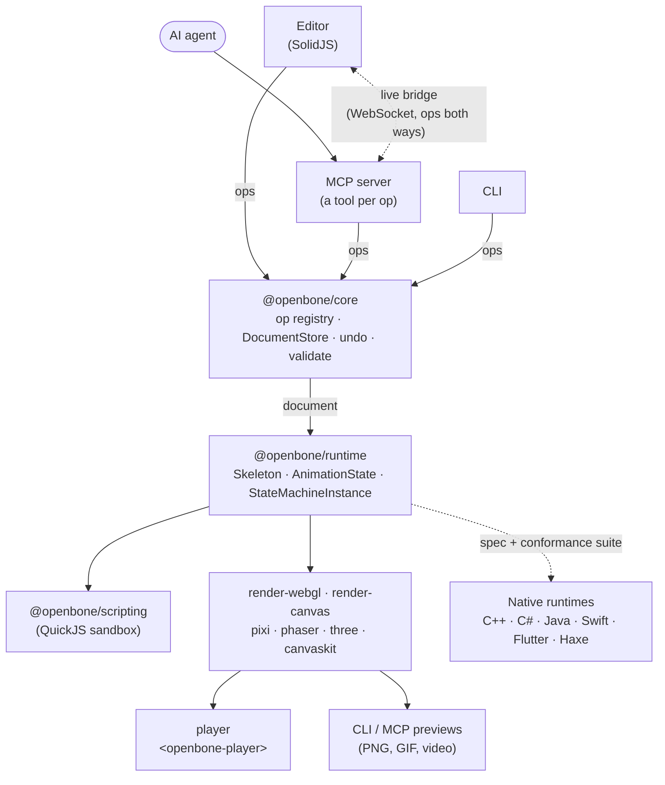

# Architecture

← [Docs](README.md)

How the pieces of OpenBone fit together: one place where documents change, one runtime that poses and plays them,
and renderers, players and engine runtimes on top.

- [Overview](#overview)
- [One op registry for everything](#one-op-registry-for-everything)
- [Runtime model](#runtime-model)
- [Rendering](#rendering)
- [Audio](#audio)
- [Scripts](#scripts)
- [Native runtimes](#native-runtimes)
- [Exports and live art](#exports-and-live-art)

## Overview

## One op registry for everything

Every change to a document is a named **op** (`addBone`, `setKeys`, `addTransition`, …), defined once in
`packages/core/src/ops/*.ts` with a zod schema, a description and an `apply(doc, args)` function.

| Who | How it uses ops |
|---|---|
| **Editor** | Calls them through `DocumentStore.apply`; undo and redo are document snapshots |
| **MCP server** | Turns every op into a tool automatically (`addBone` → `add_bone`): the zod schema becomes the tool's input schema and the description its description. Adding an op adds a tool |
| **Live bridge** | Sends ops over WebSocket. Generated ids are written back into the op's arguments before broadcast, so replaying it on another replica gives an identical document |
| **CLI** | `apply` runs any op against a file |

References accept **ids or names** everywhere, which keeps agent prompts short.

## Runtime model

### Coordinates

Skeleton space is **y-up**, with rotations in degrees counter-clockwise. The artboard is y-down pixels;
`originX`/`originY` place the skeleton's (0, 0) on it.

### A frame

Animation values are **absolute** (as in Rive): a key says "rotation = 45", not "setup + 45". Each frame the runtime:

1. resets to the setup pose,
2. applies the animation tracks or state-machine layers with their alpha, then script overrides,
3. applies sliders, solves the bones' world transforms, then the constraints in one ordered list
   (by default IK, transform, path, physics; each constraint may carry an `order`),
4. builds the draw list.

The full, port-exact order is in the [runtime specification](runtime-spec.md#3-per-frame-pipeline).

### Constraints

- **IK** is analytic (law of cosines) in world space, with softness and stretch.
- **Transform** constraints blend world matrices, or local values in `local` mode.
- **Path** constraints sample an arc-length table of the bezier path.
- **Physics** constraints run spring particles at a fixed timestep fed by `Skeleton.update(dt)`, so a given sequence of
  frame times always gives the same result.
- Keyable constraint values live in `Skeleton.constraintValues`: reset to the setup values each frame, written by
  timelines and input bindings.

### State machines

Each frame: pointer events → listeners → script `onUpdate` → transitions (specific before any-state; a transition with
no conditions waits for exit time 1; then a state's `onComplete` once its animation has played through) → advance →
pose → script overrides → **input bindings** → events → script `onEvent`. Blend states report events only from their
dominant animation.

### Particles

Each slot showing a `particles` attachment has an emitter simulated at fixed 1/60 s steps with a seeded random
generator. Players and state machines advance it in real time through `Skeleton.update(dt)`. The editor timeline and
image/video exports instead call `seekAnimation(sk, anim, t)` (`Skeleton.seekParticles`), which replays every missing
step from time 0, so a given time always shows the same particles. Each emitter becomes one draw item with per-vertex
colours.

### Text

Text attachments are resolved when the draw list is built: the template is filled from `Skeleton.textValues` (the
running state machine's inputs, by name) unless `Skeleton.setText` overrides it. Draw items carry a `text` record
(content, style, box size, box-to-world matrix) for the renderer to draw.

## Rendering

The runtime produces a **renderer-agnostic draw list**: world vertices, uvs, indices, colour, dark colour and blend
mode per slot. Items under a clipping mask share a `clip` region (its world outline plus triangulation).

| Renderer | How it draws |
|---|---|
| **WebGL2** | Batches by texture, blend mode and mask; writes each mask into the stencil buffer; rasterises text to a cached per-slot texture; draws particles with a built-in soft-dot texture |
| **Canvas2D** | Clips to the mask outline; maps each textured triangle with an affine transform; fills shapes as paths; draws text with `fillText` |
| **PixiJS, Phaser, Three.js, CanvasKit** | Share `packages/engine-kit`, which produces the same batches as WebGL2 (checked frame for frame in their tests) |

**Texture atlas.** When the document has an atlas, packed images point at their atlas page with uvs remapped into it,
and shapes sample the page's white block, so a packed skeleton draws from one texture. The packer
(`packages/core/src/atlas.ts`, MaxRects) is pure; `buildAtlas` (render-canvas) measures visible bounds and outlines,
lays out, draws, optionally premultiplies and encodes the PNG pages. The editor's Export dialog, the MCP `pack_atlas` /
`export_file` tools and the CLI all call it. Renderers learn which pages are premultiplied from
`premultipliedTextures(doc)`.

## Audio

The runtime never touches an audio API. `AudioDirector` (`packages/runtime/src/audio.ts`) turns triggers into audio
commands: `play` (with an instance id), `stop` (with a fade) and `fade`, emitted by `AnimationState`,
`StateMachineInstance` and `OpenBoneInstance`.

- **Triggers**: animation audio keys (deduplicated per owner for loops, so a looping animation does not stack copies),
  event audio (from keys, listeners and scripts), state enter/exit hooks, and `playSound` / `stopSound` listener actions.
- **Ownership**: each track entry and each state instance owns the sounds it started. When it ends (replaced, completed,
  state exited) its looping sounds stop with `max(cross-fade, sound.fadeOut)`; one-shots run to their end.

Whoever hosts the runtime plays the commands:

| Host | Player |
|---|---|
| Editor and `<openbone-player>` | `WebAudioBackend` (`packages/player/src/audio.ts`): cached decoded buffers, a gain node per bus into a master gain, fades; resumes the AudioContext on the first pointer or key event and drops one-shots requested before that |
| Godot | `OpenBoneSprite` plays them through `AudioStreamPlayer` children |
| Cocos2d-x | `OpenBoneNode` plays them through `cocos2d::AudioEngine` |
| Unity | the **OpenBone Audio** component, through pooled `AudioSource`s |
| Flutter | `OpenBoneAudio` (flutter_soloud), on by default in `OpenBoneWidget` |

## Scripts

Scripts are plain JavaScript run through a `ScriptHost`. `@openbone/scripting` gives each script its own QuickJS
runtime with a memory cap and a per-call deadline. Values cross the boundary as JSON through a single bridge function,
so scripts cannot reach host objects. `trustedFunctionHost` (in the runtime) is available for trusted content and
tests. Native runtimes embed QuickJS (C++, Swift, Flutter, Java) or use Jint (C#) with the same `ob` API and limits; the Haxe
runtime runs them on the JavaScript engine of its JS target and skips them elsewhere.

## Native runtimes

The runtimes in `runtimes/` are ports, not wrappers: each follows the [runtime specification](runtime-spec.md) and
proves it against the [conformance suite](../conformance/README.md), which records the TypeScript runtime's poses,
draw lists, events, audio commands and state-machine steps for every example and a set of focused rigs.

| Runtime | Approach |
|---|---|
| C++ (`runtimes/cpp`) | The native core, with a stable C API (`openbone.h`) |
| Swift, Flutter | Thin wrappers over the C++ runtime's C API |
| C# (Unity), Java (libGDX, Android) | Full ports in their own language |
| Haxe (`runtimes/haxe`) | Full port in pure Haxe for every Haxe target; scripts on the JS target only |

## Exports and live art

**Exports.** `packages/mcp/src/export.ts` (`exportFile`) produces every headless export format; the MCP `export_file`
tool and `openbone export` both call it, so they write byte-identical files.

**Live art reloading.** `apps/editor/src/watch.ts` maps changed files to assets (`watch-match.ts`), shows new pixels
through the image/audio URL overrides (file-based art) or stores a new `data:` URL (embedded art), and updates sizes
with `store.applyQuiet("updateImage", …)`, which applies the op to the document and to every undo/redo snapshot
without adding an undo step.
