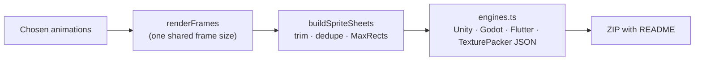

# Engine and platform exports

← [Docs](README.md)

The Export dialog's **Engines** group packages animations for engines and apps as files they already understand.
Every export is a ZIP with a README.

> [!TIP]
> For full rigs in an engine (live posing, state machines, inputs, scripts, sound), use a native runtime instead:
> Godot, Unreal, Cocos2d-x, SDL2 and SFML (`runtimes/cpp`), Unity (`runtimes/csharp`), libGDX and Android
> (`runtimes/java`), iOS and macOS (`runtimes/swift`) or Flutter (`runtimes/flutter/openbone`). The packs here are for when
> pre-rendered frames are enough, or when you want the whole web player inside an app with no native integration.

- [What each export contains](#what-each-export-contains)
- [Sprite sheets](#sprite-sheets)
- [WebView packages](#webview-packages)
- [The bridge](#the-bridge)

## What each export contains

| Entry | Kind | What you get |
| --- | --- | --- |
| **Unity** | sprite sheet | PNG sheet(s), TexturePacker JSON (hash, with pivots), `<name>.unity.json` and `Editor/OpenBoneSpriteSheetImporter.cs`, which slices the sheet (custom pivots at the skeleton origin) and creates one `.anim` clip per animation |
| **Godot 4** | sprite sheet | PNG sheet(s), a `SpriteFrames` `.tres` (one `AtlasTexture` per unique frame, `margin` restores trimmed borders; fps and loop per animation) and an `AnimatedSprite2D` `.tscn` whose position is the skeleton origin |
| **Flutter** | sprite sheet **or** WebView | Sheet + JSON + a dependency-free Dart widget (`CustomPainter`) and a Flame component; or the interactive WebView package below with a `webview_flutter` controller |
| **Android** | WebView | Kotlin `OpenBoneView` (wraps `WebView`, loads from `assets/`) |
| **iOS** | WebView | Swift `OpenBoneView` (`WKWebView`) and a SwiftUI `OpenBoneAnimation` wrapper |
| **Sprite sheet** | sprite sheet | PNG sheet(s), TexturePacker JSON hash and array, Phaser 3 multi-atlas (for PixiJS, Phaser, Cocos, …) |

## Sprite sheets

- `apps/editor/src/export-engines.ts` renders each chosen animation with `renderFrames`. All clips share one frame size:
  the artboard, or the union of the content bounds over every frame.
- `buildSpriteSheets` (`packages/export/src/spritesheet.ts`) trims transparent borders (offsets kept in
  `spriteSourceSize`), stores pixel-identical frames once (`aliasOf`), and places them with the MaxRects packer from
  `packages/core/src/atlas.ts` on as many sheets as needed.
- The metadata writers in `packages/export/src/engines.ts` are pure string/object builders, tested in
  `packages/export/test/engines.test.ts`.

Frame names are `<animation>_0001`, …; fps, loop and the origin are in `meta.openbone` of the JSON files.

## WebView packages

These keep state machines, inputs, listeners, scripts and touch by embedding the web player:

| Piece | What it is |
|---|---|
| `packages/player/src/bundle/webview.ts` | The entry of a single classic script (`openbone-player.js`): player, renderers, runtime and the QuickJS sandbox with its `.wasm` inlined. `@openbone/core` is aliased to `bundle/core-lite.ts`, so the op registry (and zod) stay out: about 0.8 MB, 0.33 MB gzipped |
| `pnpm build:player-bundle` | Writes `packages/player/dist/openbone-player.js`. The editor does not need it: a Vite plugin (`apps/editor/vite.config.ts`) builds the same bundle with esbuild into the virtual module `virtual:openbone-player-bundle`, loaded lazily by the dialog, so exports work offline with no prebuilt file |
| `index.html` | Made by `webViewHtml` (`packages/export/src/webview.ts`); embeds the `.obone`/`.obonb` as base64 so it works from `file://` (no `fetch`) |
| `preview.html` | Drives the page through the bridge from a desktop browser |

## The bridge

`packages/player/src/bridge.ts` connects the page to the host app.

**Host → page**: `OpenBone.receive(command)` with one of:

| Command | Effect |
|---|---|
| `{type: "setInput", name, value}` | Sets a state-machine input |
| `{type: "fire", name}` | Fires a trigger |
| `{type: "play", animation?, loop?}` | Plays an animation |
| `{type: "pause"}` | Pauses |
| `{type: "setSkin", name}` | Switches the skin |
| `{type: "useStateMachine", name?}` | Starts a state machine |
| `{type: "getInputs"}` | Asks for the current inputs |

iframes can send `postMessage({openbone: command})`.

**Page → host**: JSON strings `{"source": "openbone", "v": 1, "type": …}` with `ready`, `event`, `stateChange`,
`inputs` and `error`, posted to:

| Host | Channel |
|---|---|
| Flutter, Android | `window.OpenBoneHost.postMessage` (Flutter channel / Android interface) |
| iOS | `webkit.messageHandlers.openbone` |
| iframes | `parent.postMessage` |
| Any page | an `openbone-message` DOM event |

> [!NOTE]
> The native templates were written without Flutter, Gradle or Xcode toolchains and are not compiled in CI. The page,
> the bundle and the bridge are tested in the browser and in `packages/player/test/`.
