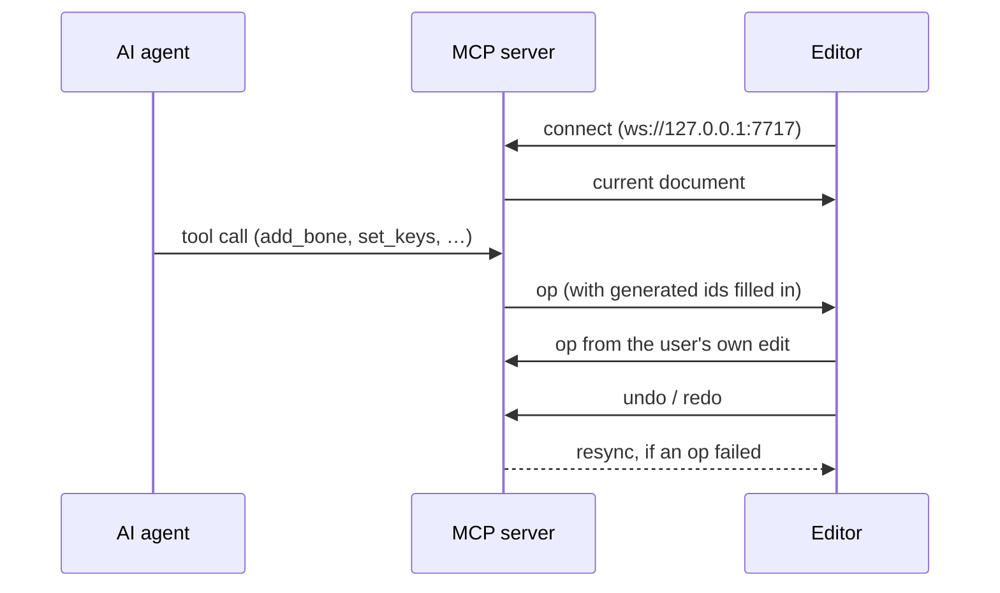

# MCP server

← [Docs](README.md)

The OpenBone [MCP](https://modelcontextprotocol.io) server lets an AI agent create and edit animations with the same
operations the editor uses, check its work with rendered frames and state-machine runs, and export the result. Every
editing op in `packages/core` is a tool automatically, so the agent can do anything the editor can.

- [Running it](#running-it)
- [Connecting a client](#connecting-a-client)
- [Tools](#tools)
- [Resources and prompts](#resources-and-prompts)
- [Live editing](#live-editing)

## Running it

| Command | What it does |
|---|---|
| `pnpm mcp` | stdio server, plus the live bridge on `ws://127.0.0.1:7717` |
| `pnpm mcp --project ~/anim/hero.obone` | opens (or creates) a project at startup |
| `pnpm mcp --http 7718` | streamable HTTP at `http://127.0.0.1:7718/mcp` |
| `pnpm mcp --no-bridge` | no WebSocket bridge |

## Connecting a client

The repository ships `.mcp.json`, so Claude Code picks up the `openbone` server automatically. For other clients:

```json
{ "mcpServers": { "openbone": { "command": "npx", "args": ["-y", "@openbone/mcp"] } } }
```

From a checkout instead of npm:

```json
{ "mcpServers": { "openbone": { "command": "pnpm", "args": ["exec", "tsx", "/path/to/OpenBone/packages/mcp/src/bin.ts"] } } }
```

`npx -y @openbone/mcp --http 7718` and the other options above work the same way.

Then ask, for example: *"Create a project at ~/anim/robot.obone: a robot with IK arms, an idle and a wave animation,
and a state machine that waves when clicked."*

## Tools

| Group | Tools |
|---|---|
| **Project** | `new_project`, `open_project`, `save_project` (projects with a path autosave after every edit), `get_summary`, `get_document`, `validate`, `undo`, `redo`, `import_image`, `import_audio` (WAV/MP3/OGG; creates a sound too), `get_guide` |
| **Editing** | One tool per core op, for example `add_bone`, `update_bone`, `add_slot`, `add_shape`, `add_region`, `add_mesh`, `auto_weights`, `add_ik_constraint`, `create_animation`, `set_keys`, `add_event_key`, `create_state_machine`, `add_input`, `add_state`, `add_transition`, `add_listener`, `add_script`, `attach_script`, `set_atlas`. `pnpm cli ops` lists them all |
| **Audio** | `add_sound`, `add_bus`, `set_audio_mix`, `add_audio_key`, `set_event_sound`, `set_state_sound` |
| **Rigging helpers** | `trace_mesh` (replace a region with a mesh traced from its image), `pose_bones` (the Pose tool: bend a bone and its parents so its tip reaches a point), `smooth_weights`, `prune_weights`, `lip_sync` (key a mouth slot to a WAV) |
| **Atlas** | `pack_atlas`: pack every image into atlas pages, with `rotate`, `scale` (a fraction or `"auto"`), `stripWhitespace`, `polygons`, `premultipliedAlpha`, page size rules (`maxWidth`/`maxHeight`, `minWidth`/`minHeight`, `square`, `multipleOf4`), `alias`, `ignoreBlank`, `alphaThreshold`, `edgePadding`, `duplicatePadding`, `bleed`, runtime metadata (`filterMin`, `filterMag`, `wrapX`, `wrapY`, `pixelFormat`), `pageFormat` (`png` or `jpeg` + `jpegQuality`), `resample` and `debug`. `export_file` takes the same settings as `atlas`, plus `scales` (one data file + page set per scale) for the `atlas` format |
| **Export** | `export_file`: everything the Export dialog makes (`obone`, `json`, `obonb`, `atlas`, `png`, `jpeg`, `apng`, `gif`, `psd`, `avi`, `mov`, `spritesheet`, `web`), from an animation or a state machine run |
| **Checking the work** | `render_frame` (a PNG with bones and hit boxes overlaid), `render_gif`, `simulate_state_machine` (a log of states, events, inputs, audio commands and script output for steps like `setInputs`, `fire`, `pointer`, `advance`), `inspect_pose` (bone world positions and rotations), `get_stats` (bones, vertices, triangles, clipping masks, estimated draw calls) |

`pack_atlas` and `export_file` run the same code as the editor's Export dialog and the CLI (`buildAtlas` and
`exportFile`), so all three produce the same files.

## Resources and prompts

- **Resources**: `openbone://guide`, `openbone://document`, `openbone://summary`
- **Prompts**: `rig_character`, `interactive_button`

## Live editing

Click **⚡ Connect MCP** in the editor to watch an agent work. The server sends its document, and from then on both
sides exchange ops:



> [!NOTE]
> The server is the source of truth: undo and redo in the editor are forwarded to it, and if an op fails the editor is
> resynced from the server's document.
