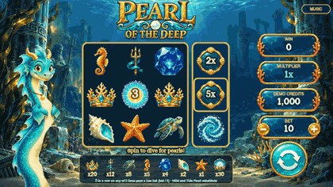

# Pearl of the Deep: a slot game example



An original underwater slot, built by an agent through the OpenBone MCP server. All of its art and sound were
generated with ElevenLabs ([licence](../assets/eleven/LICENSE.md)). It plays in **demo credits only**: there is no
real money and nothing to buy. When the credits run out, the next spin tops them back up to 1,000.

Open it from the editor's **☰ Menu → Examples…** (*Pearl of the Deep*) and press **▶ Play**. You can also open
`pearl-of-the-deep.obone` with the MCP server or the CLI.

## How it plays

- **Reels.** There are three reels of three rows and a fourth **Depth reel** of multipliers (1x, 2x, 3x, 5x, 10x, 15x,
  20x, 25x, 50x, 100x, 500x, 1000x) and the **Riptide** symbol. Only the Depth reel's framed centre cell counts.
- **Paylines.** Five lines (the three rows and both diagonals) pay for 3 in a row, left to right, in multiples of the
  line bet (the bet ÷ 5): crown 20, trident 12, turtle 8, seahorse 5, sapphire 4, conch 2, starfish 1, and 30 for three
  Wilds or Tide Pearls.
- **Wild.** The Wild stands in for any symbol.
- **Tide Pearl (Super Wild).** The Tide Pearl lands on reels 1 to 3 with a number N. It is also a wild. On a winning
  spin, each Tide Pearl in view picks N multipliers from the Depth reel's set and adds them to the win multiplier.
- **Riptide (nudge).** When the Riptide is in the Depth reel's centre on a winning spin, the current nudges the reel two
  or three times. It adds up each multiplier that lands in the frame.
- **Ondra's Blessing.** About one spin in twelve, Ondra glows while the Depth reel slows down. If the reel lands on a
  multiplier, it rises 2 to 4 steps up the ladder. If it lands on the Riptide, it stays a Riptide.
- **Win** = line pays × multiplier. A win of at least 15× the bet is a **big win**: the screen dims, coins burst out,
  a fanfare plays and Ondra rears up and cheers.

The sim used to tune the paytable puts the return near 97 % with a hit on about one spin in four. These numbers are
for the demo only.

## How it is built

| Part | How |
|---|---|
| Reel cells | One slot per cell, each with a **sequence attachment** (the 9 symbols, then their motion-blurred copies) whose frame is a number input (`cell00`…`cell33`). One clipping mask covers the reel window. |
| Spinning | The script scrolls each reel bone down (`ob.setBone`), shifts symbols as cells wrap and shows the blurred frames. Reels stop left to right with a small bounce, and each stop fires a `reelStop` event. |
| Values | The Depth-reel values (`sv0`…`sv3`) and Tide Pearl numbers (`pw00`…`pw22`) are text attachments bound to inputs. The meters show `{balance:#,##0}`, `{bet}`, `{win:#,##0}` and `{multiplier}x`. |
| Flow | State machine layer **game**: `idle → spinning → reveal → win / bigwin → idle`. Entering `spinning` sets `phase = 1`, and that starts the spin in the script. The script then sets `phase` 5 (stopped), 2, 3 or 4. |
| Mascot | Ondra is one painted image traced into a mesh and weighted to a four-bone spine. Layer **guardian** plays idle, happy, cheer and blessing, picked by the `mood` input. |
| Sound | The spin loop and the click are set on `spinning` with `set_state_sound`. The chime is on `win` and the fanfare on `bigwin`. Reel stops, Riptide surges and pearl picks are event sounds (`set_event_sound`). The music plays on its own layer on the music bus, and the **MUSIC** button mutes it (`musicOff`). |
| Effects | A coin fountain (coins preset with the generated coin) and sparkles are keyed on the win animations, and bubbles rise behind the reels. |

The script is `pearl-game` in the project, attached to the whole state machine. The Spin button's listener fires the
`spin` trigger. The ± buttons call the script's `betUp` / `betDown` functions (5, 10, 20, 50 or 100).

## Testing a spin

Two inputs make spins repeatable:

- `seed`: any number above 0 makes the random numbers repeat.
- `force`: the next result, read once and then cleared. Give three reels top to bottom, then the Depth-reel centre
  (`m<value>` or `r` for Riptide). Add `|bless` for the Blessing, and `pearl:N` gives a Tide Pearl with N picks.

```text
seahorse,wild,sapphire|seahorse,pearl:2,sapphire|seahorse,starfish,sapphire|m2   three rows win, Tide Pearl ×2
turtle,conch,crown|starfish,wild,seahorse|crown,trident,turtle|r|bless           both diagonals, Riptide, Blessing
```

For example, with the MCP server:

```json
{ "tool": "simulate_state_machine", "steps": [
  { "setInputs": { "seed": 42, "force": "seahorse,crown,conch|trident,crown,starfish|sapphire,crown,turtle|m5" } },
  { "fire": ["spin"], "advance": 4 } ] }
```

That spin pays crown on the middle line: 20 × line bet 2 = 40, × 5 = 200, a big win at a bet of 10.
